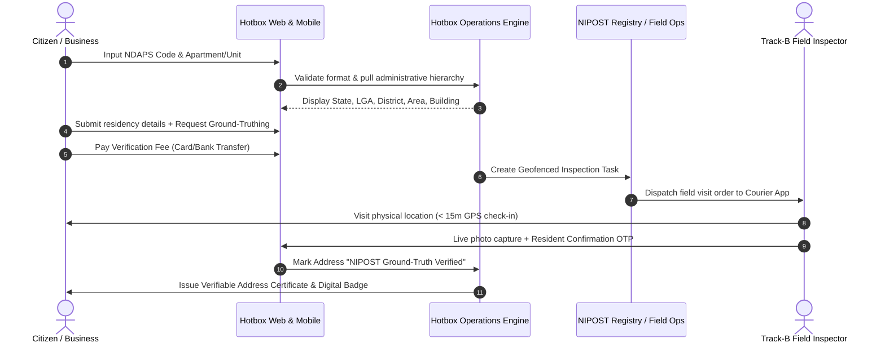
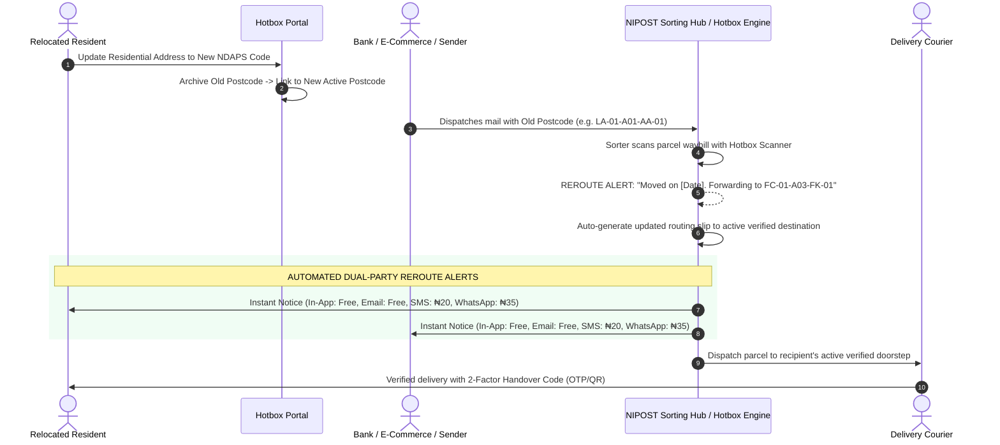

# HOTBOX PLATFORM — STRATEGIC PROPOSITION
## Repurposing NDAPS Alphanumeric Postcodes into the National Digital P.O. Box & Proof-of-Address Network
**Domains:** `hotbox.com.ng` | `hotboxng.com` | **Authoritative Partner:** Nigerian Postal Service (NIPOST)

---

## 1. Executive Summary & Problem-Solution Matrix

Historically, the traditional Post Office Box (**P.O. Box**) was the backbone of Nigerian mail delivery. However, physical boxes suffer from systemic obsolescence:
1. **Location Rigidity**: Citizens must travel to physical postal depots to retrieve mail.
2. **Address Abandonment**: When citizens relocate between apartments or cities, old boxes are abandoned, leading to lost letters, undelivered bank tokens, missed legal notices, and lost postal revenues.
3. **No Ground-Truthed Proof of Address**: Traditional P.O. Boxes cannot verify where someone physically sleeps or operates a business, forcing Nigerian banks, fintechs, and embassies to rely on forged utility bills.

**Hotbox** reimagines the National Digital Alphanumeric Postcode System (**NDAPS**) from a static postal code into an active, **Dynamic Digital P.O. Box** and **Physical Ground-Truthed Identity Layer**.

```
+---------------------------------------------------------------------------------------------------+
|                                      HOTBOX PLATFORM CORE                                         |
|                                (hotbox.com.ng / hotboxng.com)                                     |
+---------------------------------------------------------------------------------------------------+
        |                                       |                                    |
        v                                       v                                    v
 [ CITIZENS & BUSINESSES ]             [ NIPOST & LOGISTICS ]              [ ENTERPRISE & KYC ]
 • Dynamic Digital P.O. Box            • 100% First-Time Delivery          • Real-time Address Verification
 • NIPOST Certified Proof of Address   • Instant In-Transit Rerouting      • Central Bank Tier-3 KYC API
 • Automatic Relocation Forwarding     • Verified Occupancy Directory      • Fraud & Identity Theft Shield
 • Guaranteed Parcel & Mail Delivery   • Predictable Recurring ARR         • Verified Business Premises
```

---

## 2. Core Value Pillars

### Pillar 1: Verified & Reliable Proof of Address (Ground-Truthing)
- **The Problem**: Over 80% of address verification in Nigeria fails or relies on outdated paper utility bills that lack geolocation precision.
- **The Hotbox Solution**:
  1. The resident enters their building's 5-segment NDAPS code (`State-LGA-District-Area-Building`, e.g. `FC-01-A05-FK-05`).
  2. Hotbox auto-pulls the official structural hierarchy from the NIPOST database.
  3. The resident attaches their identity profile (NIN, Phone Number, Apartment/Flat Number) and requests **Official Ground-Truthing**.
  4. An accredited NIPOST Postal Inspector or certified Track-B field courier is dispatched to the physical premises with geofenced GPS verification ($\le 15\text{m}$ tolerance) and doorway photographic capture.
  5. Upon confirmation, the user receives an official **NIPOST-Certified Proof of Address Badge & Verifiable Digital Certificate** (with tamper-proof QR code), accepted by banks, embassies, and regulatory authorities.

### Pillar 2: The Dynamic Digital P.O. Box
- **The Problem**: When people move, their physical mail dies.
- **The Hotbox Solution**:
  1. Every verified resident and corporate entity is assigned an active **Digital P.O. Box Anchor** linked to their phone number, NIN, and primary NDAPS code.
  2. Unlike a metal box in a postal hall, the Digital P.O. Box follows the citizen anywhere in Nigeria.
  3. Senders address mail using the recipient’s Name, Phone, and current NDAPS Postcode.
  4. Sorters and last-mile dispatchers scan the item using the Hotbox Scanner:
     - **Active & Current**: Direct last-mile delivery to the doorstep or nearest Partner Hub.
     - **Relocated**: If the citizen has moved, Hotbox flags the change: *"Resident relocated on [Date]. Auto-rerouting to verified new address: [New Postcode]"*.
     - The parcel/letter is rerouted immediately without missort penalties or return-to-sender loops.

### Pillar 3: Guaranteed Mail & Parcel Delivery
- Couriers arriving at high-density buildings, estates, or commercial plazas can scan the building’s NDAPS code in the Hotbox Rider app.
- The app pulls the **Verified Occupancy Directory** for that building unit:
  - Confirms whether the recipient is an active resident, co-tenant, or business occupant.
  - Displays the specific flat, suite, or floor number.
  - Completes delivery via cryptographic 2-factor collection code (OTP/QR), ensuring zero lost mail.

---

## 3. Sustainable Revenue Model for NIPOST

Traditional postal revenues from stamp duties and physical box rentals have declined. Hotbox introduces a high-margin, dual-stream revenue ecosystem:

```
+---------------------------------------------------------------------------------------------------+
|                                  NIPOST REVENUE STREAMS                                           |
+---------------------------------------------------------------------------------------------------+
| 1. Ground-Truthing Fee         | One-time fee (₦2,500 – ₦5,000) paid by individuals/businesses    |
|                                | for physical field verification of their address.                |
| 2. Annual Digital Box Renewal  | Yearly recurring subscription (₦3,000 – ₦6,000/yr) to maintain   |
|                                | active proof of address, verified badge, and instant rerouting.  |
| 3. Relocation Forwarding Fee   | Premium instant parcel rerouting service across states/LGAs.     |
| 4. B2B Enterprise KYC API      | Per-query micro-charge (₦100 – ₦250) to commercial banks,        |
|                                | fintechs, and credit bureaus for real-time address validation.   |
+---------------------------------------------------------------------------------------------------+
```

---

## 4. End-to-End Operational Workflows

### Flow A: Resident Onboarding & Physical Ground-Truthing


### Flow B: Automated Dual-Party Relocation & Mail Forwarding


---

## 5. Automated Dual-Party Reroute Alerts & Channel Pricing

When a parcel or letter is redirected due to address relocation, **both the sender** (e.g. commercial bank sending credit cards, e-commerce merchant, or court issuing legal notices) and **the recipient** (relocated citizen/tenant) receive instant notices confirming the mail was redirected safely.

### Notification Channel Matrix & Fee Structure

| Channel | User Cost | Delivery Protocol | Description & SLA |
| :--- | :--- | :--- | :--- |
| **In-App Notification** | **₦0.00 (100% Free)** | Real-time WebSocket / DB feed | Instant notification bell counter and timeline feed in both Customer and Enterprise consoles. |
| **Email Alert** | **₦0.00 (100% Free)** | SMTP / Resend Domain Gateway | Complete HTML dossier with tracking ID, original postcode, new destination, and courier status. |
| **SMS Direct Notice** | **₦20.00 / SMS** | Termii DND Bypass / Twilio GSM | High-priority GSM text message delivered to recipient's and sender's registered mobile phones. |
| **WhatsApp Dispatch Card**| **₦35.00 / WhatsApp**| Termii WhatsApp Cloud API | Rich interactive WhatsApp message with real-time parcel tracking link and 2-Factor OTP collection code. |

> [!IMPORTANT]
> **Free Tier Guarantee**: In-App and Email alerts are permanently free of charge (₦0.00) to ensure zero friction and 100% notification coverage. SMS and WhatsApp alerts are billed directly to the user's prepaid logistics wallet upon dispatch, with double-entry ledger auditing in `transactions`. Users retain full autonomy in their profile to activate or deactivate any paid channel.

---

## 6. Layering Plan on Existing Codebase & Specs

This proposition integrates seamlessly into the architecture defined in [`Spec.md`](file:///C:/Users/NITDA/Desktop/herdr-project/custom_tasks/dropboxz/Spec.md) and [`prompt.txt`](file:///C:/Users/NITDA/Desktop/herdr-project/custom_tasks/dropboxz/prompt.txt):

| Hotbox Layer | Current Architecture Component | Layering Integration |
| :--- | :--- | :--- |
| **Dual-Party Reroute Engine** | `backend/src/services/notificationService.js` | `dispatchDualPartyRerouteAlert` orchestrating free In-App/Email and paid SMS/WhatsApp with wallet deductions. |
| **Digital P.O. Box Preferences** | `backend/src/routes/customer.js` | Dedicated `PUT /notification-preferences` and `POST /test-reroute-alert` endpoints. |
| **Dynamic Scanner Forwarding** | `frontend/src/components/CustodyScanner.jsx` | Added `RELOCATION_FORWARDING` transition allowing sorters/riders to scan and auto-reroute items. |
| **Citizen Settings & Simulator** | `frontend/src/components/CustomerDashboard.jsx` | Full 4-channel preference manager with live pricing badges and interactive reroute test simulator. |
| **Physical Ground-Truthing** | `backend/src/routes/operations.js` & `VerificationQueue.jsx` | Add "Address Verification" mission type to existing Track-B courier inspection queues. |
| **B2B Address Verification** | `backend/src/routes/enterprise.js` & `EnterprisePortal.jsx` | Provide API key management for banks & fintechs to query `GET /api/v1/verify-address?postcode=...&phone=...`. |
| **Branding & Domains** | `frontend/src/*` | Transition UI copy, headers, metadata, and logos from **Dropboxz** to **Hotbox** (`hotbox.com.ng` / `hotboxng.com`). |

---

## 7. Strategic Enhancements & Recommendations

1. **Tamper-Proof Certificate of Address (PDF)**:
   - Provide citizens with a downloadable, NIPOST-branded official PDF containing the resident's photo, NIN, geocoordinates, verified NDAPS code, verification date, and an encrypted QR code for instant bank authentication.
2. **Multi-Tenant Building Management**:
   - For plazas and high-rise apartments sharing a single building code, Hotbox introduces a sub-unit format: `[NDAPS]-U[Floor/Flat]` (e.g. `FC-01-A05-FK-05/F03`), preventing identity collisions.
3. **Automated Dual-Party Reroute Assurance**:
   - Commercial senders (e.g. Access Bank, GTBank) receive cryptographic proof of delivery reroute, eliminating chargebacks and disputes regarding lost debit cards or misplaced physical legal notices.
4. **Privacy-Preserving Courier Lookup**:
   - Couriers scanning an address only see the recipient's name, active unit, and delivery instructions—never sensitive financial details, NIN, or historical residency timelines.
5. **Grace Period & Renewal Governance**:
   - If a citizen's annual digital box subscription lapses, mail is held safely at the nearest accredited Partner Hub for 14 days with automated reminders before any storage fees accrue.
